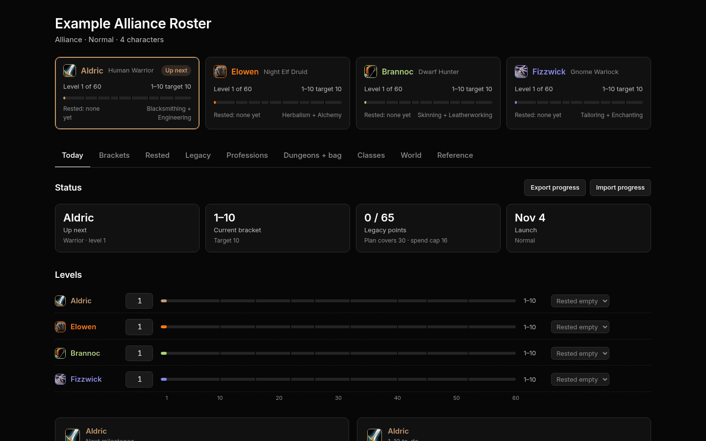
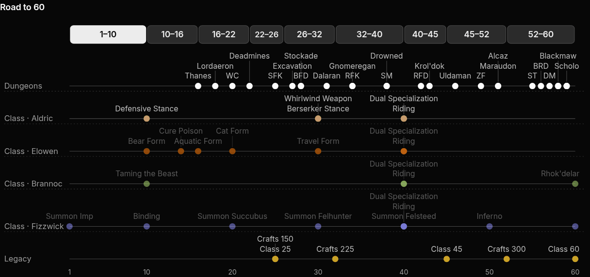
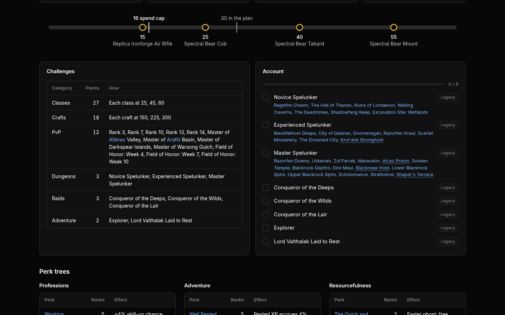
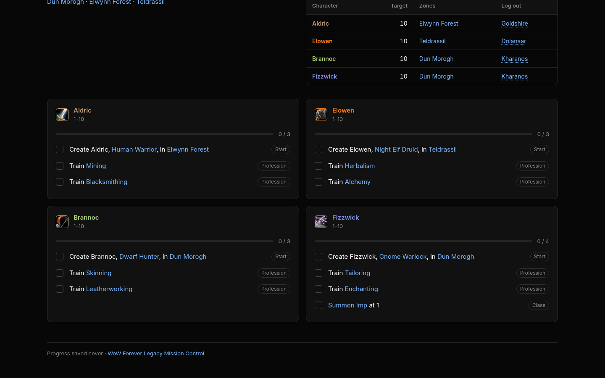
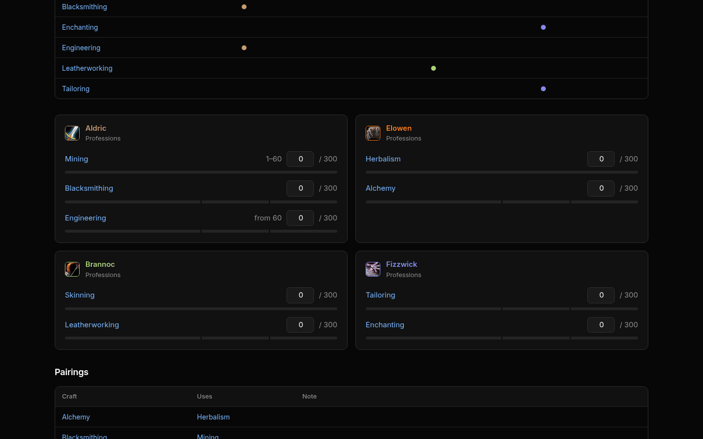
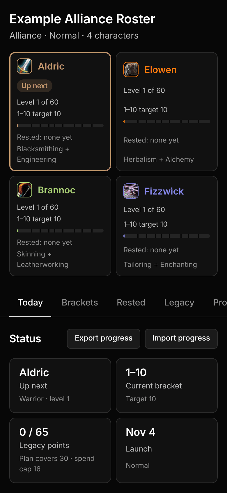
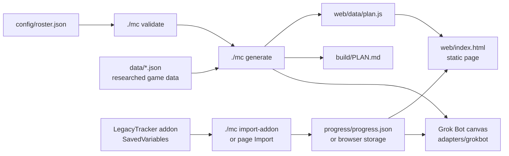
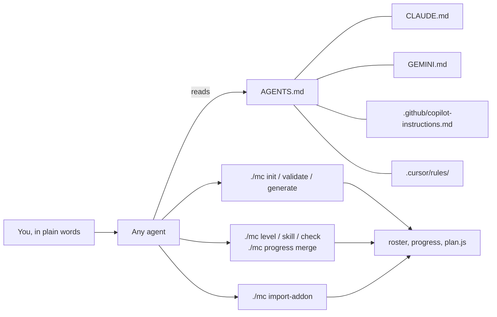
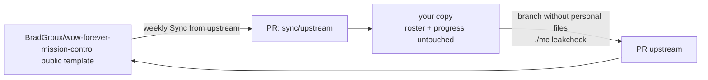

# WoW Forever Legacy Mission Control

A planner and progress tracker for four players (or one player with four characters) leveling together in **World of Warcraft: Forever** from launch on **November 4, 2026**, built to earn as many **Legacy points** as possible on the way to 60.

You describe your four characters in one config file. Mission Control checks that the roster is legal, that the four characters' professions cover all six crafting professions, and then writes a personal plan:

- a level-by-level road to 60 for each character, with class quests, spell and talent milestones, dungeons, and zones for your faction
- profession targets (150 by 25, 225 by 32, 300 by 52) so the craft Legacy challenges land on time
- the Legacy reward track, account checklist (Spelunker tiers, raids, adventure) and a points projection
- a static web page with checklists, editable levels and rested state, saved in your browser, with JSON export and import
- an optional silent in-game addon, **LegacyTracker**, that records levels, XP, rested XP and profession skill so you never type them in

Every game name links to [Wowhead's WoW Forever database](https://www.wowhead.com/forever). Anything not yet confirmed for Forever is marked **Unverified** or **Classic data** on the page.

**Demo:** [bradgroux.github.io/wow-forever-mission-control](https://bradgroux.github.io/wow-forever-mission-control/) (the example Alliance roster).



| Road to 60 | Legacy |
| --- | --- |
|  |  |
| **Brackets** | **Professions** |
|  |  |



## How it fits together



Progress lives in your browser (localStorage) and moves as JSON; see [Progress and sync](docs/progress.md). Updates flow from this repo into your copy by pull request; see [Updating](docs/updating.md). Agents drive everything through `./mc`; see [AGENTS.md](AGENTS.md).

## Quick start

You need Python 3.9 or newer and nothing else. No packages, no build step.

1. **Make your own copy.** Use the green **Use this template** button on GitHub (you can make it private), or fork it, or download the ZIP. Then clone it.
2. **Describe your roster.**
   ```sh
   ./mc init          # answers a few questions, writes config/roster.json
   ./mc validate      # legal race/class combos, four characters, craft coverage
   ./mc generate      # writes web/data/plan.js, build/PLAN.md and the Grok Bot canvas
   ```
   On Windows, run `python mc init` and so on.
3. **Open the page.** Open `web/index.html` in your browser, or run `./mc serve` and go to http://localhost:8000. To share it with your group, host it on [GitHub Pages, Cloudflare Pages or ChatGPT Sites](docs/hosting.md).
4. **Track progress.** Tick checklists and set levels on the page. Or install the [LegacyTracker addon](docs/addon.md) and import its data with the page's **Import progress** button or `./mc import-addon`.

`make` users: every `./mc` command has a Makefile target (`make init`, `make generate`, `make serve`, `make check` ...).

## Use it with an AI agent (any platform)

The repo is written so any coding or personal agent can run it: Grok Bot, Muse, ChatGPT and Codex, Claude and Claude Code, Cursor, GitHub Copilot, Gemini, and others. [AGENTS.md](AGENTS.md) is the single source of instructions; `CLAUDE.md`, `GEMINI.md`, `.github/copilot-instructions.md` and `.cursor/rules/` point to it. Per-platform tips are in [docs/agents/](docs/agents/README.md).

Ask your agent something like:

> Set up WoW Forever Legacy Mission Control for my group. Interview me for our four characters, validate the roster, and generate the page.

Later:

> I'm level 23 on Aldric with full rested. Elowen hit 150 Alchemy. Update our progress.

Agents do everything through the same `./mc` commands, so nothing depends on a particular platform.


 Grok Bot users can also get a live canvas Page from [adapters/grokbot/](adapters/grokbot/README.md).

## No agent? Manual path

Everything works by hand:

1. Copy `config/examples/alliance.json` (or `horde.json`) to `config/roster.json` and edit names, races, classes, specs and professions. The [config reference](docs/config.md) lists every field and allowed value. Or run `./mc init` for a guided interview.
2. Run `./mc validate` and fix any errors it prints.
3. Run `./mc generate`, then open `web/index.html`.
4. Play. Tick items on the page. Use **Export progress** to save a JSON backup or send it to your group, and **Import progress** to load someone else's export or a `LegacyTracker.lua` file from the addon.
5. To keep progress in the repo for everyone, run `./mc progress merge progress-YYYY-MM-DD.json` (or `./mc import-addon <path>`), then `./mc generate` and commit.

`./mc plan` prints the whole plan as Markdown if you prefer a document; see [docs/examples/alliance-plan.md](docs/examples/alliance-plan.md).

## The LegacyTracker addon

[addon/LegacyTracker](addon/LegacyTracker) is a tiny, silent addon (Interface 16001) that works with any character names. It has no UI and prints nothing except when you type `/ltrack`. It records level, XP, rested XP, zone and profession skill for each character on the account; gold and time played only if you opt in. To share with your group, send `./mc scrub-addon` output, not the raw file. Install it into `World of Warcraft\_forever_\Interface\AddOns\`, play, then import `WTF\Account\<ACCOUNT>\SavedVariables\LegacyTracker.lua` on the page or with `./mc import-addon`. Full steps: [docs/addon.md](docs/addon.md).

## Staying up to date

Game data will change after launch. Your copy can pull fixes and new data from this repo:

- **Automatic:** the included [Sync from upstream](.github/workflows/sync-upstream.yml) workflow checks weekly and opens a pull request in your copy. It never touches your roster or progress files.
- **Manual:** `make sync`, or the git commands in [docs/updating.md](docs/updating.md).



## Contributing

Corrections and new data are very welcome, especially Horde routes, class quest details, racials and anything that changes at launch. You don't need to code: a Wowhead link in an issue helps. Start with [CONTRIBUTING.md](CONTRIBUTING.md) and the issues labeled [good first issue](https://github.com/BradGroux/wow-forever-mission-control/labels/good%20first%20issue). Please follow the [Code of Conduct](CODE_OF_CONDUCT.md).

## What's in the repo

```
mc                      the one CLI (Python 3.9+, standard library only)
Makefile                make targets for every mc command
config/                 roster.schema.json, examples/; your roster.json goes here
data/                   researched game data with sources (classes, races, world, professions, legacy, Wowhead ids)
web/                    the static page (index.html, app.js, style.css, data/)
addon/                  LegacyTracker addon and its test harness
adapters/grokbot/       optional Grok Bot canvas Page
scripts/                mc implementation and the SavedVariables parser
tests/                  unit tests
docs/                   setup, config, addon, progress, hosting, updating, data, FAQ, agents
```

## Docs

[Setup](docs/setup.md) · [Config reference](docs/config.md) · [Addon](docs/addon.md) · [Progress and sync](docs/progress.md) · [Hosting](docs/hosting.md) · [Updating](docs/updating.md) · [Game data](docs/data.md) · [FAQ](docs/faq.md) · [Agents](docs/agents/README.md)

## License

[MIT](LICENSE), copyright Brad Groux. World of Warcraft is a trademark of Blizzard Entertainment. This is a fan project, not affiliated with Blizzard or Wowhead.
