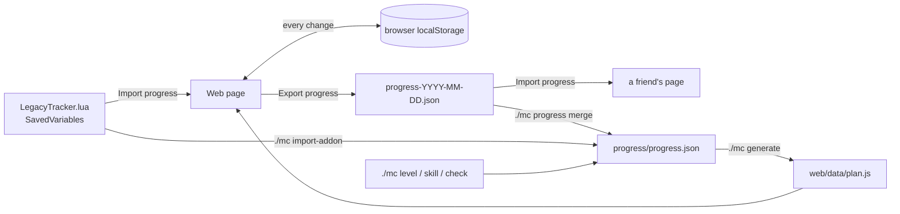

# Progress and sync




Progress is a small JSON document:

```json
{
  "version": 1,
  "roster": "example-alliance-roster",
  "updated": "2026-11-10",
  "checks": { "1-10-aldric-p-mining": true },
  "levels": { "aldric": { "level": 14, "rested": "Partial", "updated": "2026-11-10" } },
  "skills": { "aldric": { "Mining": 110, "Blacksmithing": 95 } },
  "map": { "Aldricthebold": "aldric" },
  "notes": ""
}
```

Checklist ids are stable (`<from>-<to>-<character id>-<item>`, or `acct-...` for account items), so a regenerated plan keeps your ticks. Changing a character's `id` loses its progress.

## Where it lives

| Place | Who sees it | How it changes |
| --- | --- | --- |
| Browser (localStorage, key `mc:<roster>:v1`) | that browser only | ticking boxes, level and rested inputs, skill inputs, **Import progress** |
| `progress/progress.json` in your repo | everyone who opens the hosted page or clones the repo | `./mc` commands, then `./mc generate` and commit |
| Grok Bot canvas `SAVED` block | the canvas | `./mc generate` writes it from `progress/progress.json` |

When the page loads it starts from `progress/progress.json` (baked into `web/data/plan.js`) and then applies what's saved in the browser on top.

## Updating progress

| You have | Do |
| --- | --- |
| Nothing, just played | Edit levels and tick items on the page |
| A level or skill to record from the CLI | `./mc level aldric 23 --rested Full`, `./mc skill elowen Alchemy 150` |
| Finished items | `./mc ids deadmines` to find ids, then `./mc check <id> ...` (`--off` to untick) |
| A page export (`progress-YYYY-MM-DD.json`) | `./mc progress merge progress-YYYY-MM-DD.json` |
| `LegacyTracker.lua` from the addon | page **Import progress**, or `./mc import-addon <path>` ([addon.md](addon.md)) |

Run `./mc generate` after CLI changes, then commit `progress/progress.json`, `web/data/plan.js` (and the canvas if you use it) so the hosted page updates.

## Merge rules

- Checks: `./mc progress merge` treats an export as the full set of ticks and replaces the checks; the page's **Import progress** sets or clears each id in the file and keeps ids it doesn't mention.
- Levels: the higher level wins; equal levels take the newer data.
- Skills: the higher value wins.
- Notes: replaced when the incoming file has notes.
- Other top-level keys (added by other tools) are kept.

## Group workflow

One person (or their agent) keeps the repo. Others click **Export progress** on the page and send the JSON, or send their `LegacyTracker.lua`. The keeper merges or imports, runs `./mc generate`, commits and pushes. If the page is hosted, everyone sees the update on the next load.

`./mc progress show` prints the current state; `./mc progress reset` clears it (asks no questions, so commit first).
