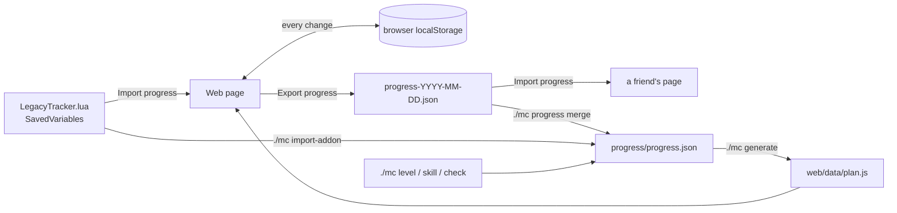

# Progress and sync




Progress is a small JSON document:

```json
{
  "version": 1,
  "roster": "example-alliance-roster",
  "updated": "2026-11-10",
  "checks": { "1-10-aldric-p-mining": true },
  "levels": { "aldric": { "level": 14, "rested": "Partial", "updated": "2026-11-10" } },
  "skills": { "aldric": { "Mining": 110, "Blacksmithing": 95 } },
  "map": { "Aldricthebold": "aldric" },
  "notes": ""
}
```

Checklist ids are stable (`<from>-<to>-<character id>-<item>`, or `acct-...` for account items), so a regenerated plan keeps your ticks. Changing a character's `id` loses its progress.

## Where it lives

| Place | Who sees it | How it changes |
| --- | --- | --- |
| Browser (localStorage, key `mc:<roster>:v1`) | that browser only | ticking boxes, level and rested inputs, skill inputs, **Import progress** |
| `progress/progress.json` in your repo | everyone who opens the hosted page or clones the repo | `./mc` commands, then `./mc generate` and commit |
| Grok Bot canvas `SAVED` block | the canvas | `./mc generate` writes it from `progress/progress.json` |

When the page loads it starts from `progress/progress.json` (baked into `web/data/plan.js`) and then applies what's saved in the browser on top.

## Updating progress

| You have | Do |
| --- | --- |
| Nothing, just played | Edit levels and tick items on the page |
| A level or skill to record from the CLI | `./mc level aldric 23 --rested Full`, `./mc skill elowen Alchemy 150` |
| Finished items | `./mc ids deadmines` to find ids, then `./mc check <id> ...` (`--off` to untick) |
| A page export (`progress-YYYY-MM-DD.json`) | `./mc progress merge progress-YYYY-MM-DD.json` |
| `LegacyTracker.lua` from the addon | page **Import progress**, or `./mc import-addon <path>` ([addon.md](addon.md)) |

Run `./mc generate` after CLI changes, then commit `progress/progress.json`, `web/data/plan.js` (and the canvas if you use it) so the hosted page updates.

## Merge rules

- **Page edits stick.** Every tick, untick, level, rested or skill change on the page is time-stamped (the `stamp` field). A stamped edit beats older data from `progress/progress.json`, so unticking a baked-in item or correcting a level downward survives a reload. A newer bake (a later `updated` date, or newer addon data) beats an older page edit.
- **CLI edits stick too.** `./mc level`, `./mc skill` and `./mc check` (including `--off`) stamp what they change, so a correction made after a page export isn't undone by that browser on reload. A later page edit still wins. `./mc import-addon` skips addon data older than a manual level edit (`--force` overrides).
- **Canvas unticks travel.** The canvas **Copy progress** JSON lists an unticked item as `false` with a stamp, so the page's **Import progress** clears it too.
- Checks: `./mc progress merge` treats an export as the full set of ticks and replaces the checks; the page's **Import progress** sets or clears each id in the file and keeps ids it doesn't mention. A file with no `checks` key (for example `./mc scrub-addon` output) leaves ticks alone.
- Levels and skills without a stamp: the higher value wins; equal levels take the newer data. Addon data that isn't newer than what's saved is skipped, on the page and in the CLI.
- Imports are checked first: levels 1–60, rested Empty/Partial/Full, skills 0–300, checks true/false, and the right container types. A file that fails is rejected with the field names and nothing changes. If the browser's saved copy is ever malformed, the page loads what is valid and keeps the original under `mc:<roster>:v1:invalid` in localStorage.
- Notes: replaced when the incoming file has notes (or a newer stamped edit, even an empty one).
- Name mappings (`map`, from `./mc map`): merged, the incoming file wins on a conflict. Page exports include them.
- Other top-level keys (added by other tools) are kept.

### Safety nets

- `./mc progress merge <file> --dry-run` and `./mc import-addon <file> --dry-run` print what would change and save nothing.
- `./mc progress merge` refuses a file that would untick five or more items and more than half of your ticks (usually a partial export); add `--force` if that's what you want.
- `./mc progress reset` needs `--force` (`--dry-run` shows what would go).
- Before `merge` and `reset`, the old file is copied to `progress/backups/progress-YYYYMMDD-HHMMSS.json` (git-ignored). Copy one back over `progress/progress.json` to undo.

## Group workflow

One person (or their agent) keeps the repo. Others click **Export progress** on the page and send the JSON, or run `./mc scrub-addon` on their `LegacyTracker.lua` and send that (the raw file covers every character on their account). The keeper merges or imports, runs `./mc generate`, commits and pushes. If the page is hosted, everyone sees the update on the next load.

`./mc progress show` prints the current state; `./mc progress reset --force` clears it after writing a backup.
