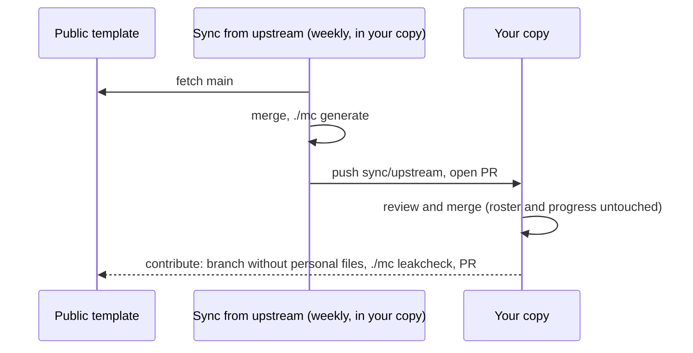

# Updating from upstream




WoW Forever data will move after launch: quest levels, racials, new dungeons, fixes. Your copy can pull those updates from [the upstream template](https://github.com/BradGroux/wow-forever-mission-control) without touching your roster or progress.

## Why updates don't clobber your data

Upstream never contains these files, so a merge never overwrites them:

- `config/roster.json`
- `progress/progress.json`
- `web/data/plan.js`
- `adapters/grokbot/mission-control.canvas.tsx`

Upstream ships `web/data/plan.example.js` instead; the page loads it first and your `plan.js` replaces it. After a sync, `./mc generate` rebuilds your files with the new data.

The only conflicts you can get are in shared files you edited yourself (README, docs, code).

## Automatic: the Sync from upstream workflow

[.github/workflows/sync-upstream.yml](../.github/workflows/sync-upstream.yml) runs every Monday (and on demand from the **Actions** tab). In your copy it:

1. fetches upstream `main`,
2. merges it into a `sync/upstream` branch,
3. runs `./mc generate` and commits the regenerated files,
4. opens (or updates) a pull request for you to review and merge.

It does nothing in the upstream repository itself.

One-time setup in your copy:

1. **Settings > Actions > General**: allow actions, and under **Workflow permissions** tick **Allow GitHub Actions to create and approve pull requests** ([GitHub docs](https://docs.github.com/en/repositories/managing-your-repositorys-settings-and-features/enabling-features-for-your-repository/managing-github-actions-settings-for-a-repository)).
2. If you **forked** the repo, open the **Actions** tab and enable workflows; GitHub disables scheduled workflows in forks until you do.
3. Optional: repository variable `MC_UPSTREAM` to sync from a different upstream URL.

Limits:

- The default `GITHUB_TOKEN` cannot push changes to files under `.github/workflows/`. When upstream changes a workflow, the run fails with a message telling you to sync manually (below). Alternatively, create a fine-grained personal access token for your copy with **Contents** and **Workflows** read and write, and save it as the repository secret `MC_SYNC_TOKEN`.
- On a merge conflict the run fails without changing anything. Sync manually and resolve it.
- GitHub disables scheduled workflows in public repositories with no activity for 60 days; re-enable it from the Actions tab.

## Manual

```sh
make sync
```

or the same steps by hand:

```sh
git remote add upstream https://github.com/BradGroux/wow-forever-mission-control.git   # once
git fetch upstream
git merge upstream/main --allow-unrelated-histories --no-edit
./mc generate
./mc validate && ./mc doctor
git push
```

`--allow-unrelated-histories` is needed the first time if you created your copy with **Use this template** (template copies start with fresh history). Files identical on both sides merge cleanly. Forks can also use GitHub's **Sync fork** button, then run `./mc generate`.

### Your own README without conflicts

Put your group's README in `.github/README.md`. GitHub shows that file on your repository's front page instead of the root `README.md`, and upstream never has it, so the root README keeps merging cleanly. Keep other personal notes in a folder upstream doesn't use (for example `personal/`).

### Resolving conflicts

`git status` lists conflicted files. For a file you never meant to change, take upstream's version:

```sh
git checkout --theirs README.md && git add README.md
git commit --no-edit
```

## After updating

- `./mc validate`: new data can turn up a new warning (for example a corrected race and class rule).
- Checklist ids are stable, so your ticks survive. An item that upstream renamed or removed simply drops out of the list.
- Have an agent? Ask it to "sync with upstream"; [AGENTS.md](../AGENTS.md) has the steps.
